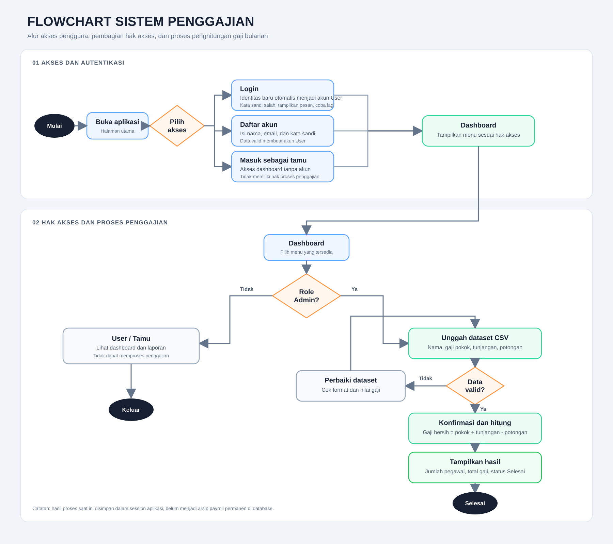

# Ruang Gaji

Ruang Gaji adalah aplikasi web untuk melihat ringkasan penggajian dan menghitung total gaji pegawai dari file CSV. Aplikasi dibuat dengan Laravel 12 dan antarmuka berbahasa Indonesia.

## Fitur

- **Akses tamu** untuk melihat dashboard dan laporan tanpa masuk.
- **Login dan pendaftaran akun** dengan peran `User`.
- Identitas baru yang dikirim melalui form login saat ini otomatis dibuat sebagai akun `User`.
- **Hak akses Admin** untuk memproses penggajian; User dan Tamu hanya dapat melihat.
- **Impor dataset CSV** dengan validasi data sebelum penghitungan.
- **Ringkasan hasil** berupa periode, jumlah pegawai, total gaji, dan status proses.
- Antarmuka dashboard untuk direktori pegawai, absensi, penggajian, dan laporan.

> **Status pengembangan:** proses penggajian saat ini menghitung ringkasan dan menyimpannya di session, belum menyimpan transaksi payroll ke database. Beberapa bagian dashboard seperti direktori pegawai dan absensi masih berupa prototype antarmuka.

## Alur sistem



## Teknologi

- PHP 8.2+
- Laravel 12
- MySQL
- Node.js dan npm
- Vite 7, Tailwind CSS 4

## Menjalankan secara lokal

Pastikan PHP, Composer, Node.js, npm, dan MySQL sudah tersedia.

1. Clone repository dan masuk ke folder project:

   ```bash
   git clone https://github.com/kristianosetiawan6-hash/website_ukk.git
   cd website_ukk
   ```

2. Pasang dependency PHP dan siapkan file environment:

   ```bash
   composer install
   ```

   Windows PowerShell:

   ```powershell
   Copy-Item .env.example .env
   ```

   macOS/Linux:

   ```bash
   cp .env.example .env
   ```

3. Buat application key. Lalu isi konfigurasi database di `.env`:

   ```bash
   php artisan key:generate
   ```

   Atur `DB_HOST`, `DB_DATABASE`, `DB_USERNAME`, dan `DB_PASSWORD` sesuai database lokal.

4. Buat tabel dan data demo:

   ```bash
   php artisan migrate --seed
   ```

5. Pasang dependency frontend dan buat aset:

   ```bash
   npm ci
   npm run build
   ```

6. Jalankan aplikasi:

   ```bash
   php artisan serve
   ```

   Buka `http://127.0.0.1:8000`.

   Untuk pengembangan frontend dengan Vite, jalankan `npm run dev` di terminal terpisah.

## Akun demo lokal

Setelah menjalankan `php artisan migrate --seed`, akun demo berikut tersedia:

| Peran | Email | Kata sandi |
|---|---|---|
| Admin | `admin@ruanggaji.test` | `password` |
| User | `user@ruanggaji.test` | `password` |

**Akun tersebut hanya untuk pengembangan lokal. Jangan gunakan atau seed kredensial demo ini di server publik.** Form pendaftaran dan pembuatan akun otomatis melalui login hanya menghasilkan User; pembuatan akun Admin harus dilakukan melalui proses administrasi yang tepercaya.

## Format file CSV penggajian

Kolom wajib: `nama` dan `gaji_pokok`. Kolom `tunjangan` dan `potongan` bersifat opsional; jika tidak diisi, nilainya dianggap `0`.

```csv
nama,gaji_pokok,tunjangan,potongan
Ayu,5000000,500000,250000
Budi,7000000,0,500000
```

Rumus gaji bersih:

```text
gaji bersih = gaji pokok + tunjangan - potongan
```

Nilai harus berupa angka nonnegatif, minimal satu baris pegawai harus tersedia, dan potongan tidak boleh melebihi gaji pokok ditambah tunjangan.

## Pengujian

Jalankan test suite Laravel:

```bash
php artisan test
```

## Deployment

Panduan deployment ke shared hosting tersedia di [DEPLOY_CPANEL.md](./DEPLOY_CPANEL.md). Jangan unggah file `.env` ke repository publik dan gunakan kredensial database serta `APP_KEY` yang aman untuk server produksi.
